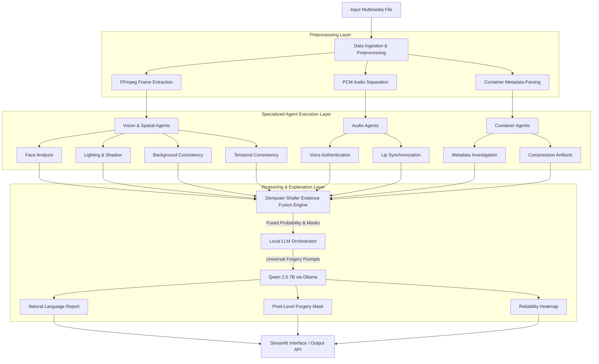
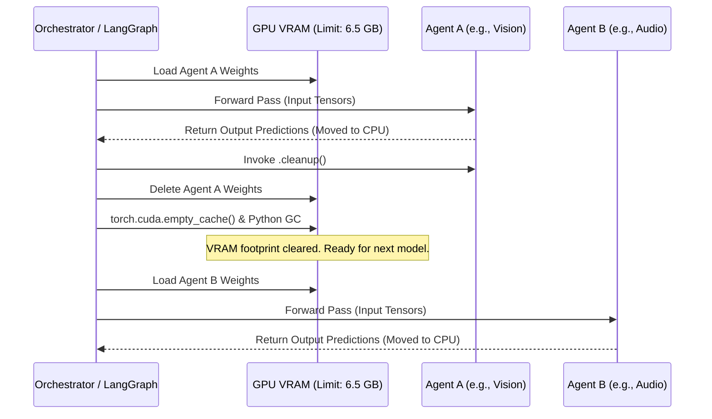

# PRISM System Architecture Specification

This document details the architectural design of **PRISM (Provenance & Reasoning Intelligence System for Multimedia)**. It serves as a technical reference for developers, researchers, and system maintainers to understand the data flows, memory management constraints, and agent-based forensic pipeline.

---

## 1. High-Level Architecture Overview

PRISM is designed as a **six-stage end-to-end pipeline**, heavily utilizing an orchestrated multi-agent design pattern via LangGraph. 

---

## 2. Core Components & Subsystems

### 2.1. Preprocessing Layer
Handles raw file unpacking to prepare data for multimodal agent ingestion.
*   **Video Processing:** Uses `Decord` or `PyAV` to extract frames efficiently directly to GPU buffers where possible. Normalizes video to 25 FPS.
*   **Audio Extraction:** Separates audio streams into raw PCM arrays (16 kHz, mono), scaled between `[-1.0, 1.0]`.
*   **Metadata Parsing:** Executes asynchronous subprocesses via `PyExifTool` to dump EXIF headers, camera serials, and container atoms.

### 2.2. Specialized Agent Layer
Eight independent forensic models acting as specific domain experts.
*   **Vision/Spatial:** 
    *   *Face Analysis:* Uses TruFor and a custom Noiseprint++ backbone to extract Photo-Response Non-Uniformity (PRNU) anomalies.
    *   *Lighting & Shadow:* Extracts depth maps via Depth Anything V2 to check for conflicting illumination vectors.
    *   *Background:* Identifies localized splicing (PhotoHolmes logic).
    *   *Temporal:* Tracks optical flow irregularities via RAFT.
*   **Audio/Temporal:**
    *   *Voice Authentication:* Detects neural vocoder signatures using AASIST/WavLM.
    *   *Lip Sync:* Aligns phoneme-to-viseme offsets via SyncNet to detect audio-visual desynchronization.
*   **Container/Signal:**
    *   *Metadata & Compression:* Analyzes DCT coefficients for double-JPEG compression traces.

### 2.3. Evidence Fusion Layer (Dempster-Shafer)
Instead of standard probability averaging (which fails on out-of-domain deepfakes), PRISM uses **Dempster-Shafer Theory**.
*   **Mass Functions:** Each agent outputs a belief mass ($m$) for *Real*, *Fake*, and *Uncertain*.
*   **Quality Discounting:** Base probabilities are discounted by environment noise coefficients ($q_v$ for visual degradation like H.264 compression, $q_a$ for acoustic noise).
*   **Conflict Resolution:** Highly conflicting agent outputs correctly drive up the "Uncertainty" mass rather than forcing a false positive.

### 2.4. LLM Reasoning Layer
Bridges the gap between raw tensor outputs and human-readable forensic reports.
*   **Universal Forgery Prompting (UF-prompts):** Fused tensors are projected via an MLP into sequence tokens (`[UF_gen, UF_spec]`) which the LLM can natively interpret alongside standard text prompts.
*   **LLM Backend:** Operates on Qwen 2.5 7B (or DeepSeek R1 fallback) via Ollama, utilizing **DoRA** (Directional Low-Rank Adaptation) fine-tuning to retain semantic generation capabilities while focusing heavily on forensic terminology.

---

## 3. Dynamic VRAM Lifecycle Management

Given the strict requirement to run on consumer hardware (4GB-8GB VRAM), PRISM employs an aggressive dynamic memory management strategy orchestrated by LangGraph.

**Memory Strategies:**
1.  **Sequential Execution:** Heavy visual agents (TruFor, Depth Anything) never reside in VRAM simultaneously. 
2.  **CPU Handoff:** Output tensors from intermediate layers are immediately detached and moved to RAM (`tensor.cpu().numpy()`).
3.  **LLM Quantization:** The Ollama daemon utilizes 4-bit quantization, allowing a 7B parameter model to run comfortably in ~4.5 GB of VRAM during the final reasoning phase.

---

## 4. Tensor Flow & Dimensionality

| Stage | Input Shape | Output Shape | Notes |
| :--- | :--- | :--- | :--- |
| **Preprocessor** | Raw Frame $\mathbb{R}^{3 \times H \times W}$ | RGB: $\mathbb{R}^{B \times 3 \times 224 \times 224}$ Noise: $\mathbb{R}^{B \times 1 \times 224 \times 224}$ | Face cropping + 4-stage PRNU residual extraction. |
| **Vision Encoder** | $\mathbb{R}^{B \times 3 \times 224 \times 224}$ | $\mathbf{F}_\text{vis} \in \mathbb{R}^{B \times 197 \times 768}$ | ViT-B/16 backbone with DoRA rank=8 (196 patches + 1 CLS). |
| **Sensor Noise Encoder** | $\mathbb{R}^{B \times 1 \times 224 \times 224}$ | $\mathbf{F}_\text{noise} \in \mathbb{R}^{B \times 196 \times 768}$ | 4-stage Conv2D + BatchNorm + GELU + Linear projection. |
| **Cross-Modal Attn** | $\mathbf{F}_\text{vis[1:]}$, $\mathbf{F}_\text{noise}$ | $\mathbf{F}_\text{fused} \in \mathbb{R}^{B \times 196 \times 768}$ | 8-head multihead attention fusing visual queries with noise. |
| **Classification Head** | $\mathbf{F}_\text{fused}$, $\mathbf{z}_\text{cls}$ | $\mathbf{y}_\text{logit} \in \mathbb{R}^{B \times 1}$ | Mean-pooled noise tokens + visual CLS token linear projection. |
| **Spatial Decoder** | $\mathbf{F}_\text{fused}$ | $M \in \mathbb{R}^{B \times 1 \times 224 \times 224}$ | 5-stage ConvTranspose2d upsampling with Sigmoid probability mask. |

---

## 5. Deployment & Scalability

While optimized for consumer hardware via sequential processing, the architecture scales naturally to high-end infrastructure:
*   **Microservices Pattern:** By replacing the local LangGraph orchestrator with a message broker (e.g., RabbitMQ), Agents C1-E2 can be deployed as independent distributed microservices.
*   **Batching:** In cloud environments (16GB+ VRAM), the dynamic offloading is bypassed, allowing concurrent agent processing and dynamic batch size scaling.

---

## 6. Demographic Invariance & Cultural Forensics Subsystem

To address real-world deepfakes beyond controlled laboratory benchmarks, PRISM incorporates physical and biometric calibrations tailored for diverse demographics, South Asian cultural attributes, and messaging app degradations:

### 6.1. Melanin-Invariant CHROM rPPG Pulse Extraction
Traditional green-channel photoplethysmography suffers significant light absorption in melanin-rich complexions (Fitzpatrick types IV-VI). PRISM adopts the **Chrominance-based (CHROM)** projection:
$$\mathbf{X}_s = 3 R_n - 2 G_n, \quad \mathbf{Y}_s = 1.5 R_n + G_n - 1.5 B_n, \quad \mathbf{S} = \mathbf{X}_s - \alpha \mathbf{Y}_s$$
where $\alpha = \frac{\sigma(\mathbf{X}_s)}{\sigma(\mathbf{Y}_s)}$. This orthogonalizes the pulse vector relative to the melanin absorption vector, enabling equitable liveness verification across all human skin tones.

### 6.2. Cultural Headwear & Dense Facial Hair Decoupling
- **Cultural Headwear (Turbans, Pagris, Hijabs)**: Forehead occlusions compress the visible vertical face bounding box. PRISM dynamically relaxes the face aspect ratio to $[0.40, 2.6]$ and shifts the ocular search band to $[15\%, 58\%]$ of the visible midface.
- **Beard-Decoupled Oral Aperture Tracking**: Dense beards and moustaches exhibit high static spatial variance ($\text{std}(\text{ROI})$). PRISM applies a spatial Gaussian filter ($\sigma = 2.0$) to eliminate follicle textures and blends temporal differential motion ($\Delta \text{ROI}_t = |\text{ROI}_t - \text{ROI}_{t-1}|$) to track true dynamic viseme articulation.
- **Phonetic Timing Tolerance**: Calibrated for Indian regional speech patterns (Hindi, Tamil, Telugu retroflex consonants), allowing temporal offsets up to $\pm 55\text{ ms}$ before penalizing audio-visual synchrony.

### 6.3. Hann-Windowed Spectral Leakage Suppression
Standard 2D FFT transforms on non-periodic rectangular images generate massive sinc cross-leakage along frequency axes, causing authentic camera photos to be misidentified as GAN/diffusion checkerboard grids. PRISM applies a 2D Hann window:
$$W(x, y) = 0.5 \left(1 - \cos\frac{2\pi x}{W-1}\right) \times 0.5 \left(1 - \cos\frac{2\pi y}{H-1}\right)$$
followed by a $9 \times 9$ median background filter. This suppresses boundary discontinuity spikes below a peak-to-average ratio of $2.5$ on natural photos while isolating genuine generative periodic lattice peaks ($> 4.0$).

### 6.4. WhatsApp Forward Robustness & Epistemic Discounting
When videos undergo WhatsApp forward compression (H.264 high quantization, 360p/480p, stripped EXIF metadata):
- Missing metadata is explicitly assigned to the **Epistemic Ignorance** mass: $m(\{T, A\}) = 1.0$.
- Dempster-Shafer fusion dynamically discounts the container agent, preventing innocent forwarded media from being falsely classified as tampered.

